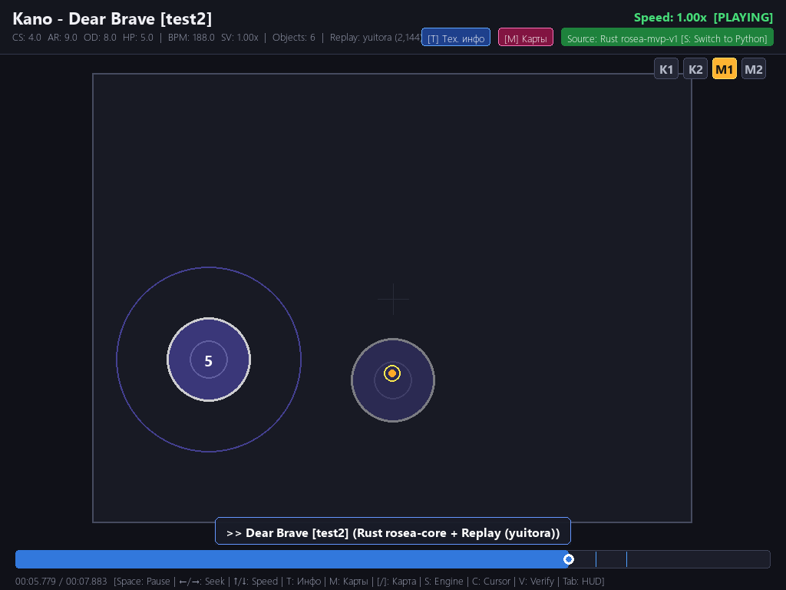
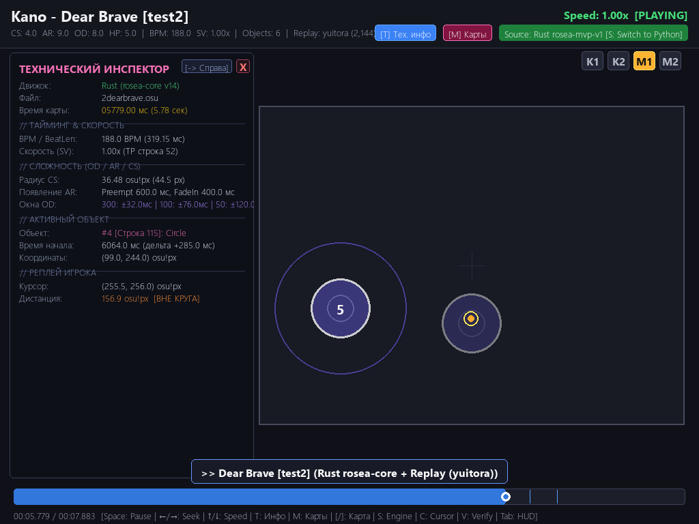
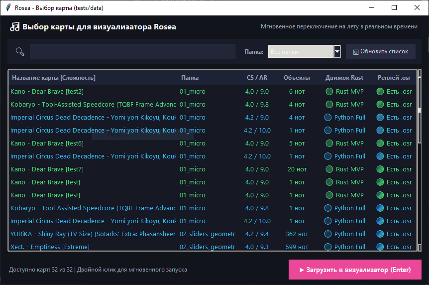

# Rosea Visualizer

Визуализатор карт osu!standard и реплеев для отладки парсера Rosea. Можно посмотреть, как рисуются объекты, перемотать карту и сравнить данные моего Rust- и полуидеал-Python-парсеров.

Для карты с реплеем видны слайдер, курсор и нажатия:

По `T` открывается панель с таймингами, координатами и строкой объекта в `.osu`:

По `M` открывается панель с выбором карты:

Реплей передаём через `--replay path/to/replay.osr`. Если `.osr` лежит рядом с картой и называется так же, он подхватится сам.

Карты в `tests/data/` визуаоизатор видит сам.

## Клавиши

| Клавиша | Действие |
| --- | --- |
| Пробел | Пауза |
| ← / → | Перемотка на 2 с, с Shift - на 5 с |
| ↑ / ↓ | Скорость воспроизведения |
| M | Выбор карты |
| [ / ] | Предыдущая / следующая карта |
| T | Техническая панель |
| S | Переключение Rust / Python, если доступны данные Rust |
| C | Показать или скрыть курсор реплея |
| V | Сравнение с Rust-парсером |
| Tab | Показать или скрыть верхнюю панель |
| R | В начало карты |

Источник данных при запуске задаётся через `--source rust` или `--source python`; 
