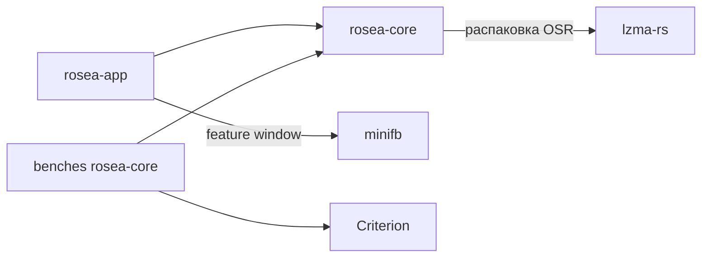

# Архитектура Rosea


Rosea воспроизводит реплеи osu!standard и рисует игровое поле собственным программным растеризатором. Профиль `rosea-mvp-v1` поддерживает карты `.osu` v14, реплеи Standard без модов и подсчёт ScoreV1. Симуляция обрабатывает события в миллисекундах и сохраняет дробные времена слайдеров.

## 1. Workspace и зависимости

```text
Cargo.toml                         # виртуальный workspace, resolver = "3"
Cargo.lock                         # общий lockfile
rust-toolchain.toml                # channel = "1.94.0", rustfmt, clippy
crates/
  rosea-core/
    Cargo.toml
    src/
      lib.rs
      model.rs                     # типы входов, координат, времени и счёта
      error.rs                     # коды ошибок и структурированные диагностики
      parse/{mod,osu,osr,uleb128,md5}.rs
      prepare/{mod,curve,timing,stacking}.rs
      replay.rs                    # нормализация потока, интерполяция и кнопки
      sim/{mod,schedule,hit,slider,spinner,score}.rs
      scene.rs                     # представление состояния для рисования
      raster/{mod,buffer,primitive,theme}.rs
    tests/
    benches/{raster,headless}.rs
  rosea-app/
    Cargo.toml
    build.rs                       # версия компилятора для метаданных отчёта
    src/{main,cli,load,report,corpus,export,window}.rs
    tests/
tests/data/                        # локальный корпус, manifest corpus.json
```

Оба пакета используют edition 2024 и `rust-version = "1.94"`. Имена библиотечного пакета и модуля - `rosea-core` и `rosea_core`. Исполняемый файл пакета `rosea-app` называется `rosea`. Корневой workspace включает оба пакета и использует общий `Cargo.lock`.



| Пакет | Ответственность | Прямые зависимости |
| --- | --- | --- |
| `rosea-core` | Разбор байтов и MD5, подготовка карты и ввода, симуляция, снимок сцены, CPU-растеризация | `lzma-rs = "=0.3.0"`, без дополнительных features. Criterion `=0.7.0` только как dev-dependency для benches с `harness = false` |
| `rosea-app` | Файлы, CLI, отчёты и корпус, часы просмотра, оконный адаптер, экспорт | Путь `../rosea-core`. `minifb = "=0.29.0"`, `optional = true`, `default-features = false`. У пакета `default = ["window"]`, `window = ["dep:minifb"]` |

MD5, CLI и обработка JSON реализуются собственным кодом на `std`. `#![forbid(unsafe_code)]` ставится в библиотеку, бинарь и собственный `build.rs`. Разрешённые прямые зависимости перечислены в таблице. Сборка без окна выполняется командой `cargo build -p rosea-app --no-default-features`. Целевые платформы для окна - `x86_64-pc-windows-msvc` и `aarch64-apple-darwin`. Сборку и smoke на каждой платформе фиксируют отдельно. [API lzma-rs](https://docs.rs/lzma-rs/latest/lzma_rs/fn.lzma_decompress_with_options.html), [API minifb](https://docs.rs/minifb/latest/minifb/struct.Window.html), [Criterion 0.7.0](https://docs.rs/criterion/0.7.0/criterion/).

Внутренние зависимости направлены от потребителя к данным. Парсеры зависят от `model` и `error`, `prepare` и `replay` работают с результатами парсинга, `sim` получает подготовленные структуры, `scene` заимствует неизменяемые данные карты и состояние симулятора, `raster` читает `Scene`. `rosea-core` принимает байты и времена от вызывающего кода. Владение файлами, системными часами и оконными объектами сосредоточено в приложении.

## 2. Типы и публичный API

Блоки Rust описывают публичный интерфейс библиотеки. Комментарии внутри структур обозначают закрытые поля. Модули `model`, `error`, `parse`, `prepare`, `replay`, `sim`, `scene`, `raster` экспортируются из `lib.rs`. Внутренние алгоритмы остаются в соответствующих модулях.

```rust
// model
pub const PROFILE_ID: &str = "rosea-mvp-v1";
pub struct ObjectId(pub u32);
pub struct Point { pub x: f32, pub y: f32 }
pub struct TimeMs(/* конечное f64, канонический +0.0 */);
impl TimeMs {
    pub fn new(ms: f64) -> Result<Self, RoseaError>;
    pub fn get(self) -> f64;
}
pub enum Judgement { Great, Ok, Meh, Miss }
pub struct HitCounts { pub count_300: u32, pub count_100: u32,
                       pub count_50: u32, pub count_miss: u32 }
pub struct Stats { pub score: u64, pub current_combo: u32,
                   pub max_combo: u32, pub counts: HitCounts }
pub struct ExpectedStats { pub score: i32, pub max_combo: u16,
    pub count_300: u16, pub count_100: u16, pub count_50: u16, pub count_miss: u16 }
pub struct ObjectCounts {
    pub circles: u32, pub sliders_l: u32, pub sliders_b: u32,
    pub sliders_p: u32, pub spinners: u32,
}
pub struct Beatmap { /* parsed difficulty, objects, timing points, breaks, metadata */ }
pub struct ReplayMeta { /* mode, version, hashes, player, flags, life graph, timestamp, trailer */ }
pub struct ReplayRecord {
    pub index: u32, pub delta_ms: i64, pub cursor: Point, pub keys: u32,
}
pub struct ReplayInput { /* Vec<ReplayRecord>, seed: Option<i32> */ }
pub struct Parsed<T> { pub value: T, pub warnings: Vec<Warning> }
pub struct ParsedReplay {
    pub meta: ReplayMeta, pub expected: ExpectedStats, pub input: ReplayInput,
}

// parse
pub fn osu(bytes: &[u8]) -> Result<Parsed<Beatmap>, RoseaError>;
pub fn osr(bytes: &[u8]) -> Result<Parsed<ParsedReplay>, RoseaError>;
pub fn beatmap_md5(bytes: &[u8]) -> [u8; 16];

// prepare и replay
pub struct PreparedMap { /* геометрия, окна, шкала событий карты */ }
pub fn prepare_map(map: &Beatmap) -> Result<PreparedMap, RoseaError>;
pub struct ReplayTimeline { /* нормализованные записи и группы равного времени */ }
pub fn normalize(input: ReplayInput) -> Result<Parsed<ReplayTimeline>, RoseaError>;

// sim
pub enum EventKind {
    Circle, SliderHead, SliderTick, SliderRepeat, SliderTail, SliderResult,
    SpinnerPoints, SpinnerBonus, SpinnerResult,
}
pub struct SimEvent {
    pub time: TimeMs, pub object_id: ObjectId, pub kind: EventKind,
    pub part_index: Option<u32>, pub part_hit: Option<bool>,
    pub judgement: Option<Judgement>, pub score_delta: u64,
    pub combo_before: u32, pub combo_after: u32,
}
pub struct Simulator<'a> { /* ссылки на PreparedMap и ReplayTimeline, состояние прогона */ }
impl<'a> Simulator<'a> {
    pub fn new(map: &'a PreparedMap, input: &'a ReplayTimeline) -> Result<Self, RoseaError>;
    pub fn advance_to(&mut self, time: TimeMs) -> Result<(), RoseaError>;
    pub fn advance_with(&mut self, time: TimeMs, emit: &mut dyn FnMut(&SimEvent))
        -> Result<(), RoseaError>;
    pub fn scene(&self) -> Result<Scene<'_>, RoseaError>;
    pub fn stats(&self) -> Stats;
    pub fn finish(self) -> Result<Stats, RoseaError>;
    pub fn finish_with(self, emit: &mut dyn FnMut(&SimEvent)) -> Result<Stats, RoseaError>;
}

// scene и raster
pub struct Scene<'a> { /* неизменяемый вид карты, времени, состояний, HUD и курсора */ }
pub struct FrameSize { /* проверенные width: u32, height: u32 */ }
pub struct FrameBuffer { /* FrameSize, Vec<u32> */ }
pub struct Rasterizer { /* переиспользуемая маска покрытия */ }
impl FrameSize {
    pub fn new(width: u32, height: u32) -> Result<Self, RoseaError>;
    pub fn width(self) -> u32;
    pub fn height(self) -> u32;
}
impl FrameBuffer {
    pub fn new(size: FrameSize) -> Result<Self, RoseaError>;
    pub fn size(&self) -> FrameSize;
    pub fn pixels(&self) -> &[u32];
}
impl Rasterizer {
    pub fn new() -> Self;
    pub fn draw(&mut self, scene: &Scene<'_>, target: &mut FrameBuffer)
        -> Result<(), RoseaError>;
}
```

`TimeMs`, `ObjectId`, `Point`, `Judgement`, `Stats`, `HitCounts`, `ExpectedStats`, `ObjectCounts`, `EventKind` и `FrameSize` реализуют `Copy`, `Clone` и `Debug`. Идентификаторы сравниваются численно. `TimeMs::new` проверяет конечность, а входные лимиты карты, ввода и экспорта проверяются на границах соответствующих стадий. `ReplayMeta` даёт read-only доступ к `game_version() -> i32` и `beatmap_hash() -> &str`. Поля `Beatmap` и `PreparedMap` открываются только через read-only методы. Для CLI нужны `Beatmap::object_count() -> u32`, `Beatmap::object_counts() -> ObjectCounts`, `ReplayTimeline::record_count() -> u32`, `PreparedMap::first_visible_at() -> TimeMs` и `Simulator::end_time() -> TimeMs`. `end_time()` вычисляется до запуска как максимум времени последней нормализованной записи и всех сроков решения карты. `first_visible_at()` берёт минимум времён появления всех объектов по §5 этого документа.

Внутри `Beatmap` записи объектов содержат `ObjectId`, исходный номер строки, начало, базовую позицию, флаги и вариант `Circle`, `Slider { kind, controls, spans, declared_length }` либо `Spinner { end }`. Карта хранит исходные timing points с индексом строки и интервалы перерывов для ScoreV1. `PreparedMap` владеет путями, префиксами длин, смещениями stacking, окнами, порогами спиннеров, параметрами ScoreV1 и отсортированными событиями. `Simulator` владеет счётом и массивом состояний объектов. Повторный прогон создаёт новый `Simulator` с теми же неизменяемыми `PreparedMap` и `ReplayTimeline`.

`scene()` доступен после первого успешного `advance_to` и заимствует текущее состояние, включая подготовленные слайдерные пути. Эксклюзивное заимствование для следующего `advance_to` начинается после завершения работы со снимком. Создавать отдельные копии путей и всех состояний для каждого кадра не требуется. `stats()` даёт промежуточные значения. Только `finish` и `finish_with` подтверждают полноту прогона. Callback журнала получает события в порядке применения. `advance_to` и `finish` используют тот же механизм с пустым обработчиком.

## 3. От файлов к подготовленной карте

```text
ограниченное чтение пары
  → MD5 сырых байтов .osu → парсер .osu
  → парсер .osr → метаданные и ExpectedStats остаются в приложении
  → проверка MD5 пары
  → prepare_map + normalize
  → Simulator → Scene → Rasterizer → FrameBuffer → окно / PPM / Y4M
               → finish → Stats + ExpectedStats → отчёт
```

Приложение ограничивает размер `.osu` до 16 MiB, а `.osr` до 64 MiB. При чтении `Read::take` разрешает один байт сверх соответствующего лимита, чтобы обнаружить превышение. Метаданные файла могут дать ранний отказ, но предел контролируется фактически прочитанными байтами. Приложение считает MD5 до передачи байтов текстовому парсеру и сравнивает результат с 32 hex-символами заголовка, принимая оба регистра. Преобразование путей и хешей выполняется до симуляции. `inspect` завершает загрузку после проверки пары и нормализации ввода, поэтому выводит предупреждения о нормализации без подготовки геометрии.

`beatmap_md5` обрабатывает 64-байтовые блоки, добавляет padding только в хвостовом локальном буфере и возвращает четыре слова в little-endian. Сложение `u32` по модулю `2^32` выполняется явно через `wrapping_add`. Проверки включают тестовые векторы RFC и хеш карты с BOM. [RFC 1321, §§3 и A.5](https://www.rfc-editor.org/rfc/rfc1321).

`parse::osu` обрабатывает строки с номером от 1, сохраняет `ObjectId` до сортировки. `parse::osr` использует курсор по срезу, проверенное сложение смещений и точный little-endian. Указанная длина compressed payload определяет отдельный срез. LZMA-поток получает `lzma_decompress_with_options` с `ReadFromHeader`, `memlimit = Some(64 * 1024 * 1024)` и `allow_incomplete = false`. Перед вызовом проверить полный 13-байтовый LZMA-заголовок, верхнюю границу объявленного словаря и известный распакованный размер, если размер отличается от `u64::MAX`. Вывод идёт через ограниченный `Write`, который прекращает декодирование при попытке превысить 256 MiB. Если предел сработал, возвращается `ResourceLimit`, прочие сбои декодирования становятся `InvalidLzma`. Trailer берётся с конца среза compressed payload, заданного OSR-заголовком. [Параметры декодера](https://docs.rs/lzma-rs/latest/lzma_rs/decompress/struct.Options.html).

После разбора `replay::normalize` накапливает целые дельты с проверкой переполнения. Он обрабатывает служебный префикс, сохраняет исходные индексы и порядок записей с одинаковым временем, а записи с обратным ходом времени отбрасывает с диагностикой. Распакованные байты можно освободить после разбора записей. `prepare` выполняется один раз в порядке геометрия → timing и вложенные события → stacking → параметры счёта и индексы событий. Геометрия хранится относительно начала пути. Stacking вычисляется по исходным мировым позициям и применяется через общий `stacked_origin` для попаданий и рендера. Геометрия и события проверяются по общим лимитам карты до роста буферов. Для f64-времени канонизируется ноль, события сортируются `total_cmp` с указанными ключами разрешения равенства.

## 4. Событийная шкала

`Simulator` сливает два упорядоченных источника двумя индексами. Первый источник - группы записей `ReplayTimeline`, второй - события карты. Индекс продвигается вперёд, поэтому одна запись применяется один раз. Для карты хранятся сроки кругов и голов, начала и концы слайдеров и спиннеров, tick, repeat и tail-check. Момент визуального появления объекта вычисляется из времени снимка и preempt. Начало окна попаданий также вычисляется из времени клика и подготовленных окон.

`advance_to(t)` обрабатывает целиком все группы с временем `≤t`. Повторный запрос того же времени допустим и не создаёт журнал. Обратный запрос возвращает `TimeWentBackwards`. Первый запрос допустим и до самого раннего события. После последних событий `advance_to` обновляет только время снимка. `finish` продвигается до `max(текущее время, end_time())` и проверяет, что число итоговых оценок совпадает с числом верхнеуровневых объектов. Если игровая операция завершилась ошибкой, экземпляр прогона считается завершённым с ошибкой и отбрасывается.

| Фаза группы времени | Порядок |
| --- | --- |
| 1. Интервал спиннера | Продвинуть от предыдущего события карты/ввода к текущему. На пересечении с интервалом спиннера используются старые кнопки и односторонние позиции курсора. Активные спиннеры обходятся по ObjectId, новые полуобороты одного объекта - по возрастанию номера. Бонус записывается с временем конца интервала, где обнаружен переход. |
| 2. Ввод | Записи одной группы по исходному индексу. Для каждой обновить курсор и кнопки, обработать Left, затем Right. Каждый фронт заново ищет доступного кандидата по `(start, ObjectId)`. После записи обновить tracking. В последней группе после всех записей применить отпускание EOF без клика и обновить tracking. |
| 3. Части слайдеров | Проверить удержание кнопки и расстояние до шарика для слайдеров, которые начинаются в этот момент или имеют собственное событие. Выполнить одну общую выборку на объект после ввода. Затем tick → repeat → tail-check, внутри вида по `(ObjectId, part_index)`. В момент start состояние уже доступно вводу фазы 2. |
| 4. Итоги | Обработать таймауты кругов/голов, финалы слайдеров и спиннеров по ObjectId. Если в этой фазе один объект закрывает голову и становится готов к итогу, сначала закрыть голову. Слайдер с поздней головой финализируется в фазе 4 той группы, где стало известно её состояние, при условии `time ≥ end`. |
| 5. Снимок | Публикуется состояние после всех эффектов группы. Каждое изменение combo обновляет max_combo непосредственно при применении события. |

Между входными группами позиция для интерполяции берётся от последней записи левой группы к первой записи правой. Для каждой оси вычислить `f32(a + (b−a)*((t−t_left)/(t_right−t_left)))`, расширив `a` и `b` до `f64` до вычитания. На правой границе интервала спиннера используется входящая позиция. После обработки группы отображается последняя позиция этой группы. До первой записи действует исходный курсор и отпущенные кнопки. Это исключает вращение от скачка на первой записи или от нескольких позиций в один момент.

Время последней обработанной группы отделено от времени, запрошенного у `scene()`. Видеокадр между группами может интерполировать курсор и шарик и показать уже накопленный угол спиннера. Он не разбивает игровой интервал и не вызывает выборку tracking, начисление бонуса или обработку кнопок. Модуль `hit` проверяет попадания и таймауты. Клик вне окна головы игнорируется, а голова без попадания получает miss при закрытии окна. Модуль `spinner` накапливает абсолютные приращения угла курсора при удержании кнопки. Завершённые полуобороты определяются как `floor(angle / π)` и служат основой для начисления бонусов и итоговой оценки.

На первом этапе поиск кандидатов выполняется по срезу объектов, отсортированному по `(start, ObjectId)`, с диапазоном потенциальных начал из W50. Активные слайдеры и спиннеры хранятся в упорядоченных списках ObjectId. Готовые исходы собираются в список текущей группы и применяются один раз. В исходных входах и плане событий отсутствуют поля ожидаемого счёта.

### 4.1. Дробное начало объекта

Время начала объекта хранится в `f64`. Целые полуокна `W300`, `W100`, `W50` получаются округлением вниз значений `80−6×OD`, `140−8×OD`, `200−10×OD` соответственно. Модуль `sim::hit` сравнивает `abs(f64(click_ms) − start) < f64(W)` и закрывает окно при `start + f64(W50)`. При OD=8 и клике в 1032 мс начало 1000.25 мс даёт 300, а начало 1000 мс даёт 100. Правило для дробных начал входит в модель best-effort и требует отдельной сверки с реплеями.

## 5. Снимок, фиксированная тема и растеризация

Все размеры темы заданы в логических единицах. Холст 640×480 вписывается в буфер с масштабом `s = min(W/640, H/480)` и центрируется. Начало поля смещено на `(64,48)` относительно холста. Преобразование выполняется в `f64`. Фон за пределами холста `#080B10`, холст `#111721`, прямоугольник поля `#172232`. Объекты и HUD клипуются по границе холста. Пиксель оценивается в центре `(column+0.5,row+0.5)`. Покрытие диска и капсулы включает точную границу. Кольцо покрывает `inner² < distance² ≤ outer²` и превращается в диск при `inner = 0`. Для прямоугольника правая и нижняя границы исключаются. Границы области обхода зажимаются к буферу в вещественном представлении перед преобразованием индексов. В MVP покрытие бинарное.

| Элемент | Размеры, цвет и время |
| --- | --- |
| Круг и голова | Диск радиуса `r`, заливка `#55B8E9`, кольцо внутрь на 2 единицы `#E8F3FF`. Видимы от `start−preempt` до решения, правая граница исключена. |
| Approach circle | Внешний радиус линейно от `4r` до `r` на `[start−preempt,start)`, толщина 2, цвет `#9AD9FF`. Скрывается после решения головы/круга. |
| Тело слайдера | Объединение капсул радиуса `r` по подготовленной ломаной, цвет `#426A9A`, максимальная непрозрачность 160. От `start−preempt` до геометрического `end`, правая граница исключена. Путь из одной точки рисуется диском. |
| Шарик и follow circle | Шарик радиуса `0.65r`, `#F3F8FF`, на `[start,end)`. При tracking кольцо толщиной 2 с внешним радиусом `f32(r*2.4_f32)` и цветом `#7ADDC0`. |
| Спиннер | На `[start,end)` кольцо с внешним радиусом 72 и толщиной 3 в `(256,192)`, цвет `#7ADDC0`. Полоса прогресса в координатах поля `(192,274)`, размер 128×5, подложка `#334256`, заполнение `#7ADDC0`. Заполненная доля `min(1,H/(req_half+1))`, при `req_half=0` доля 1. |
| Курсор | Диск радиуса 5, `#F8D96E`, отображается в интерполированной позиции. |
| HUD | Системные шрифты не требуются. Цифры и `S C X M` задаются масками 3×5, верхняя строка старшая, каждый бит рисует прямоугольник 2×2, шаг символа 8. Цвет `#E8F3FF`. Координаты холста `(64,12)` для `S` и score, `(320,12)` для `C` и current_combo, `(464,12)` для `X` и max_combo. На `y=448` позиции `x=64,192,320,448` подписаны `300`, `100`, `50`, `M` и показывают соответствующие счётчики. Между подписью и числом пробел, число десятичное без начальных нулей. |

Непрозрачность круга, головы, approach circle и тела слайдера растёт линейно от нуля до их максимума за первые 400 мс видимости. Максимум равен 255, если таблица не указывает другое. Альфа округляется к ближайшему целому с `floor(a+0.5)` и зажимается в [0,255]. После последнего игрового события окно удерживает итоговую сцену и HUD до закрытия. Цвета карты разбираются и сохраняются как метаданные. В MVP применяется таблица темы.

Шарик для tracking и снимка берётся из одной функции подготовленного пути. При положительной `span_duration` зажать `q = (t−start)/span_duration` в `[0,N]`. При `q=N` взять индекс span `N−1` и локальную долю `u=1`. Иначе `j=floor(q)` и `u=q−j`. Аргумент `path` равен `u` на чётном span и `1−u` на нечётном. При нулевой длительности берётся `path(1)` для нечётного числа проходов и `path(0)` для чётного. Глифы HUD заданы пятью строками сверху вниз. Пробел использует нулевую маску.

```text
0 111 101 101 101 111
1 010 110 010 010 111
2 111 001 111 100 111
3 111 001 111 001 111
4 101 101 111 001 001
5 111 100 111 001 111
6 111 100 111 101 111
7 111 001 010 010 010
8 111 101 111 101 111
9 111 101 111 001 111
S 111 100 111 001 111
C 111 100 100 100 111
X 101 101 010 101 101
M 101 111 111 101 101
```

Порядок наложения слоёв: фон, поле, тела слайдеров, подходящие кольца, круги/головы, шарики и follow circles, спиннеры, курсор, HUD. Внутри слоя объекты рисуются по убыванию `(start, ObjectId)`, чтобы ранний объект был сверху. Для тела одного слайдера `Rasterizer` заполняет переиспользуемую маску покрытия в ограничивающем прямоугольнике. Все сегменты записывают объединение покрытия, затем смешивают цвет с буфером один раз на пиксель. Значение каждого канала вычисляется целочисленно как `(src*a + dst*(255−a) + 127)/255`. Маска очищается в рабочем прямоугольнике перед следующим телом. Буфер кадра и маска переиспользуются.

## 6. CLI и отчёты

```text
rosea inspect --map MAP.osu --replay REPLAY.osr
rosea compare --map MAP.osu --replay REPLAY.osr [--json] [--strict]
rosea compare --corpus corpus.json [--json] [--strict]
rosea play --map MAP.osu --replay REPLAY.osr [--width W] [--height H]
rosea frame --map MAP.osu --replay REPLAY.osr --at-ms T --out FRAME.ppm [--width W] [--height H]
rosea export --map MAP.osu --replay REPLAY.osr --from-ms T0 --to-ms T1 --out FILE.y4m [--fps F] [--width W] [--height H]
```

`--out -` разрешён для frame/export и пишет бинарный поток в stdout. Значения путей обрабатываются как `OsString`/`PathBuf`, числовые аргументы читаются как ASCII, поддерживают отрицательное время. Время должно быть конечным и по модулю не превышать 86 400 000 мс. Ширина и высота допустимы от 64 до 4096 при площади до 8 388 608 пикселей, частота экспорта — целое число от 1 до 240 FPS. У каждого параметра одна запись. `--help` выводит справку, ошибки синтаксиса возвращают 2. Значения по умолчанию 1024×768, 60 FPS. `frame` и `export` требуют явного времени. Для `export` необходимо `T0<T1`. Файловый вывод создаёт новый файл через `create_new`; совпадение пути с существующим файлом - ошибка. Сбой после открытия может оставить частичный результат, stdout остаётся потоком без отката. Успешный вывод требует завершения записи и `flush`.

`inspect` выводит хеш, версию, число объектов и нормализованных записей и предупреждения. `compare` выполняет полный headless-прогон. В `report` сравниваются шесть полей, `delta` вычисляется в `i128`, JSON записывает целые десятичные числа без преобразования во float. Клиентам, читающим полный диапазон, нужен JSON-декодер с точными целыми. Локализация относится только к сообщениям, а ключи схемы и коды стабильны.

```json
{
  "schema_version": 1,
  "profile_id": "rosea-mvp-v1",
  "platform": {"os": "windows", "arch": "x86_64", "rustc": "1.94.0"},
  "game_version": 20200427,
  "beatmap_md5": "25f72aeff4d84f8e2ea3da6ece1df135",
  "comparison": "MISMATCH",
  "fields": {
    "score": {"expected": 466, "actual": 465, "delta": -1, "equal": false},
    "max_combo": {"expected": 3, "actual": 3, "delta": 0, "equal": true},
    "count_300": {"expected": 1, "actual": 1, "delta": 0, "equal": true},
    "count_100": {"expected": 0, "actual": 0, "delta": 0, "equal": true},
    "count_50": {"expected": 0, "actual": 0, "delta": 0, "equal": true},
    "count_miss": {"expected": 0, "actual": 0, "delta": 0, "equal": true}
  },
  "limitations": ["NOTELOCK_NOT_IMPLEMENTED", "CLIENT_VERSION_RULES_NOT_EMULATED", "STABLE_COMPATIBILITY_BEST_EFFORT", "SLIDER_TRACKING_EVENT_SAMPLED", "SCORE_MULTIPLIER_F64_APPROXIMATION"],
  "warnings": [],
  "findings": [],
  "error": null
}
```

Пример показывает форму отчёта и использует условный `actual`. При ошибке сравнение `UNAVAILABLE`, `fields: null`, `error` - объект с `code`, `message`, `context`. `game_version` и `beatmap_md5` могут быть `null`, пока эти значения неизвестны. Предупреждение содержит `code`, `message`, `context`. Массив `findings` зарезервирован для отдельно проверенных объяснений расхождений и по умолчанию пуст. `build.rs` записывает версию компилятора из `RUSTC --version`, `os` и `arch` берутся из целевой сборки. При `--json` отчёт идёт одним JSON-документом в stdout, диагностика процесса идёт в stderr.

`compare --corpus` принимает существующий формат `tests/data/corpus.json`. Корневой массив содержит объекты с уникальными строковыми `id`, `beatmap_file` и `replay_file`. Пути разрешаются относительно каталога манифеста, остальные поля пропускаются структурно. Собственный JSON-токенизатор в `corpus` поддерживает строки с escape и Unicode, числа, булевы, null, массивы и объекты для разбора этого формата. Лимиты манифеста - 8 MiB, глубина 64 и 10 000 пар. Повтор обязательного ключа или ID считается ошибкой манифеста. Ожидания для сравнения извлекаются из `.osr` каждой пары. Обработать пары в порядке манифеста, продолжая после ошибки отдельной пары. Отчёт содержит `schema_version`, `profile_id`, `runs` с `id` и отчётом пары, `summary` с `total`, `completed`, `errors`, `exact_matches`, `exact_among_completed`, `completed_among_total` и `deltas`. Доли - объекты `{numerator, denominator}` или `null` при нулевом знаменателе. `deltas` содержит по шести полям отсортированные массивы `{delta,count}` завершённых пар, включая нулевую разницу. Выход 2 при любой ошибке пары или самого манифеста, иначе 1 при `--strict` и любом `MISMATCH`, иначе 0. Для одиночного `compare` действуют те же коды выхода.

## 7. Окно и экспорт

`play` запускает minifb в главном потоке. Окно фиксированного размера получает готовый `&[u32]` через `update_with_buffer`. Начальное время просмотра `min(0, first_visible_at())`. Адаптер использует `Instant` и накопленное время без пауз. На Space с `KeyRepeat::No` время фиксируется или запускается от зафиксированной отметки. Пока окно на паузе, цикл продолжает обработку оконных событий. При отставании рендера следующий кадр запрашивает актуальное время напрямую, `advance_to` обрабатывает всю пропущенную очередь. Escape или закрытие окна завершает просмотр. В headless-сборке `play` возвращает `WindowUnavailable` с подсказкой о feature `window`. [Формат буфера и управление окном minifb](https://docs.rs/minifb/latest/minifb/struct.Window.html#method.update_with_buffer).

Экспортёр принимает `&FrameBuffer` и `Write`, а приложение отвечает за выбор файла или stdout. Для PPM используется `P6\n{W} {H}\n255\n`, затем R,G,B из сдвигов `u32`, в порядке строк. Внутренний тест кодировщика на 2×1 работает со срезом двух пикселей, поэтому ограничения размера пользовательского кадра остаются в `FrameSize`.

Для Y4M заголовок `YUV4MPEG2 W{W} H{H} F{F}:1 Ip A1:1 C444 XCOLORRANGE=LIMITED\n`. Каждый кадр начинается с `FRAME\n`, затем ровно `W*H` байтов Y, столько же Cb и Cr в этом порядке. Размеры нечётной ширины или высоты допустимы в C444. Заголовок и границы кадра используют ASCII LF. BT.601 limited range считается непосредственно из восьмибитных R′G′B′. [BT.601](https://www.itu.int/rec/R-REC-BT.601/), [формирование заголовка Y4M в FFmpeg](https://github.com/FFmpeg/FFmpeg/blob/master/libavformat/yuv4mpegenc.c).

```text
L = 299*R + 587*G + 114*B
Q(n,d) = floor((n + floor(d/2)) / d)
Y  = clamp(Q(16*255000 + 219*L,                   255000), 16,235)
Cb = clamp(Q(128*225930 + 112*(1000*B - L),       225930), 16,240)
Cr = clamp(Q(128*178755 + 112*(1000*R - L),       178755), 16,240)
```

В этой записи все итоговые числители `Q` положительны, арифметика выполняется в `i64`. Округление к ближайшему целому, точная половина вверх. Контрольные значения `(Y,Cb,Cr)` для чёрного `(16,128,128)`, белого `(235,128,128)`, красного `(81,90,240)`, зелёного `(145,54,34)`, синего `(41,240,110)`. Рабочий буфер одной плоскости переиспользуется для трёх последовательных записей. `export` строит индекс `n` от нуля и каждый раз вычисляет `t0 + (n*1000)/F` в f64, пока `t<t1`. Время представления одного кадра не округляется к миллисекунде. Рендер и запись завершённого кадра предшествуют запросу следующего.

## 8. Диагностика, интеграция и проверка

`RoseaError` реализует `std::error::Error` и содержит устойчивый `ErrorCode`, сообщение и `SourceLocation`. У `SourceLocation` предусмотрены `Line { line: u32, object_id: Option<ObjectId> }`, `ByteOffset(u64)`, `ReplayRecord(u32)`, `Object(ObjectId)` и отсутствие позиции. Код ошибки выводится под именем варианта, например `UnsupportedMods`, `InvalidLength`, `BeatmapHashMismatch`, `ResourceLimit` или `NumericalError`. `ResourceLimit` несёт имя ресурса, предел и наблюдаемую величину. `rosea-app` добавляет путь исходного файла и стадию `read`, `parse`, `prepare`, `normalize`, `simulate`, `render` либо `write`. Номера строк начинаются с 1, смещения байтов и индексы записей - с 0. В JSON `context` - объект с применимыми ключами `stage`, `path`, `line`, `byte_offset`, `record_index`, `object_id`, `resource`, `limit`, `observed`. `ReplayInputNormalized` дополнительно содержит `changes` в порядке применения правил с исходным `record_index`, причиной удаления либо парой `old_ms`/`new_ms`. Ошибки IO преобразуются с сохранением причины. Синтаксические ошибки CLI используют `UsageError`. В CLI `main` возвращает `ExitCode` после закрытия буферов вывода.

Независимые тесты парсеров и численных контрактов находятся в `rosea-core`. Тесты `rosea-app` проверяют exit codes, схемы отчётов, обработку путей, байты PPM/Y4M и headless-ветку. Метаморфный тест меняет ожидаемые поля `.osr` и проверяет неизменность вычисленной статистики и журнала. Второй тест сравнивает полный headless-прогон с запросами снимков при 30/60/144 FPS и с повторяющимися временами. `tests/data/` подключается по явному пути и отсутствует в обязательных модульных тестах. Для Criterion `raster` измеряет `Rasterizer::draw` на готовой сцене и переиспользуемом буфере. `headless` включает продвижение времени, чтение сцены и растеризацию, с подготовкой карты и вводом вне замера. Графический smoke и декодирование экспортного потока выполняются отдельно от Criterion.

